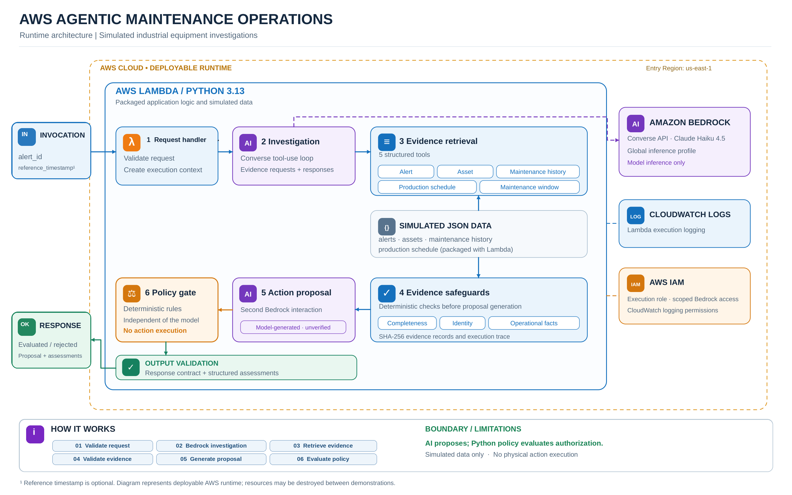

# AWS Agentic Maintenance Operations

[](https://github.com/HeathMSmith/aws-agentic-maintenance-ops/actions/workflows/ci.yml)


A simulation of an agentic AI workflow for investigating industrial equipment alerts, gathering maintenance evidence, and evaluating proposed actions against deterministic operational policies.

The project explores how Amazon Bedrock's Converse API and tool-use capabilities can support maintenance investigations without giving a language model direct authority to approve operational actions.

The workflow can run locally using scripted Bedrock responses or in AWS using a Python 3.13 Lambda function that invokes Claude Haiku 4.5 through Amazon Bedrock. Terraform manages the Lambda function, its IAM permissions, and CloudWatch logging.

Both execution environments use simulated maintenance data. No real equipment is controlled, and proposed maintenance actions are not executed automatically.

The offline demonstration does not require AWS resources or incur Bedrock inference charges.


## Problem Statement

Equipment alerts often require information from several systems before an engineer can decide what to do. An elevated vibration reading, for example, may need to be evaluated alongside asset criticality, maintenance history, production schedules, and available maintenance windows.

This project simulates that investigation process.

Rather than relying on a model's response alone, the workflow retrieves structured evidence through defined tools, validates the returned data, and submits a proposed maintenance action for separate policy evaluation.

## Architecture




The workflow separates evidence collection, action proposal generation, and policy evaluation.

1. An equipment alert initiates an investigation.
2. The Bedrock Converse conversation loop requests maintenance evidence through defined tools.
3. Local tools retrieve data from simulated maintenance records.
4. Tool responses are validated and captured as evidence records.
5. The model produces an investigation summary and submits a structured action proposal.
6. A deterministic policy evaluator determines whether the proposed action is permitted or requires approval.

The workflow includes five evidence-retrieval tools:

- `get_equipment_alert`
- `get_asset_context`
- `get_maintenance_history`
- `get_production_schedule`
- `get_maintenance_window_status`

A separate `evaluate_proposed_maintenance_action` tool supports policy evaluation. Policy enforcement is handled independently of the model's narrative response.

### Authorization Boundary

A model-generated statement is not treated as operational authorization.

For example, the model may suggest an immediate equipment shutdown, but the deterministic policy evaluator can still return `requires_approval`.

Incomplete investigations are rejected before action-proposal generation or policy evaluation.

## Running the Offline Demonstration

The offline demonstration executes the investigation workflow using a scripted Bedrock-compatible client. It does not make AWS API calls.

### Prerequisites

- Python 3.13
- Git

### Installation

Clone the repository:

```bash
git clone https://github.com/HeathMSmith/aws-agentic-maintenance-ops.git
cd aws-agentic-maintenance-ops
```

Create and activate a virtual environment:

```bash
python3 -m venv .venv
source .venv/bin/activate
```

Install the dependencies:

```bash
python -m pip install -r requirements-dev.txt
```

### Run the Investigation

From the repository root:

```bash
python -m examples.run_offline_investigation
```

The demonstration investigates `ALERT-0001`, an equipment anomaly involving conveyor motor `CONV-MTR-042`.

Its output includes the investigation summary, evidence-tool execution trace, validated evidence records, structured action proposal, and policy decision.

The sample uses a fixed reference timestamp for repeatability.

### Run the Tests

```bash
python -m pytest -q
```

The tests cover local tools, evidence validation, Bedrock conversation handling, investigation workflow behavior, action proposals, and policy enforcement.


## AWS Deployment

The investigation workflow also runs as an AWS Lambda function using Amazon Bedrock for live model inference. Terraform manages the Lambda function, its execution role, Bedrock permissions, and CloudWatch logging.

The deployed environment uses the same simulated maintenance datasets as the offline demonstration. It does not connect to industrial control systems or execute maintenance actions.

### Infrastructure

The Terraform configuration in `terraform/` creates:

- A Python 3.13 Lambda function named `agentic-maintenance-ops`.
- A dedicated Lambda execution role with scoped CloudWatch Logs and Bedrock permissions.
- A CloudWatch log group with seven-day retention.

The Lambda function runs outside a customer-managed VPC. It invokes Claude Haiku 4.5 through the global Bedrock inference profile `global.anthropic.claude-haiku-4-5-20251001-v1:0`.

Terraform state is stored in an existing S3 bucket using a dedicated state key and native S3 locking. The state bucket is managed separately from this repository.

### Build the Lambda Package

From the repository root:

```bash
bash scripts/build_lambda.sh
```

The script installs Python 3.13-compatible Linux x86_64 dependencies, copies the application code and simulation datasets, removes Python cache files, and creates:

```text
build/lambda/aws-agentic-maintenance-lambda.zip
```

The generated ZIP is excluded from Git. The build script normalizes file timestamps, removes environment-specific pip installation artifacts, and sorts ZIP entries before packaging. These steps prevent differences in filesystem traversal order and installed Python interpreter paths from changing the deployment artifact.

Reproducibility was verified by comparing SHA-256 hashes from repeated macOS builds and a GitHub Actions Linux build. All three produced identical ZIP files for the tested source revision.

### GitHub Actions CI/CD

GitHub Actions handles application testing, Lambda packaging, Terraform validation, and infrastructure deployment. The workflows are defined in `.github/workflows/`.

| Workflow | Purpose |
|---|---|
| `ci.yml` | Runs application tests, builds the Lambda package, and validates Terraform configuration. |
| `aws-oidc-test.yml` | Verifies that GitHub Actions can authenticate to the AWS deployment account through OIDC. |
| `terraform-plan.yml` | Manually generates a Terraform plan for reviewing infrastructure changes. |
| `terraform-apply.yml` | Manually generates and applies a saved Terraform plan. |
| `terraform-destroy.yml` | Manually removes the Terraform-managed application infrastructure after explicit confirmation. |

#### AWS Authentication and Bootstrap Resources

Deployment workflows authenticate to AWS using GitHub Actions OIDC and a dedicated IAM role, `agentic-maintenance-ops-github-deploy-role`. No long-lived AWS access keys are stored in GitHub for these workflows.

The role's deployment permissions are scoped to this project's Lambda function, execution role, CloudWatch log group, and Terraform state objects. The policy definition is maintained in `bootstrap/iam/github-deployment-policy.json`.

The GitHub deployment role, its attached IAM policy, and the Lambda execution role's permissions-boundary policy are bootstrapped outside this Terraform configuration. They are not created or destroyed by the application workflows.

The workflows use the GitHub `dev` environment, which restricts deployment to `main`. Terraform Plan, Apply, and Destroy also share a concurrency group to prevent overlapping infrastructure operations.

#### Terraform Deployment and Teardown

Terraform uses the existing S3 state bucket `hms-terraform-state-portfolio`, with a state key dedicated to this project and native S3 state locking.

Plan and Apply build the Lambda ZIP before evaluating Terraform configuration. Apply generates a saved plan and applies that exact plan within the same workflow run.

Destroy follows the same approach using a saved destroy plan. It requires manual execution from `main` and the exact confirmation phrase `DESTROY`. Invalid confirmation or branch selection causes the job to fail before AWS credentials are configured.

The confirmation phrase is a guard against accidental execution, not an independent approval mechanism. The `dev` environment currently does not require reviewer approval.

Destroy removes the five Terraform-managed application resources: the Lambda function, its execution role, two inline IAM policies, and the CloudWatch log group. It does not delete the externally managed deployment role, permissions boundary, or shared S3 state bucket.

The workflow intentionally retains the Lambda packaging step for consistency with the other Terraform workflows, even though generating an application ZIP is not inherently necessary for deleting infrastructure.


### Deploy with Terraform

The deployment requires AWS credentials with permission to manage Lambda, IAM, CloudWatch Logs, and the configured S3 Terraform backend.

Initialize Terraform:

```bash
AWS_PROFILE=portfolio terraform -chdir=terraform init
```

Build the Lambda package before planning or applying infrastructure changes.

Set the artifact path:

```bash
export TF_VAR_lambda_zip_path="$(pwd)/build/lambda/aws-agentic-maintenance-lambda.zip"
```

Review the planned changes:

```bash
AWS_PROFILE=portfolio terraform -chdir=terraform plan
```

Apply the configuration after reviewing the plan:

```bash
AWS_PROFILE=portfolio terraform -chdir=terraform apply
```

The `portfolio` profile is used for this project's deployment environment. Other environments can use their own AWS credential configuration.

Amazon Bedrock inference and AWS infrastructure usage may incur charges.

### Invoke the Investigation

Invoke the deployed Lambda function using the simulated alert:

```bash
AWS_PROFILE=portfolio aws lambda invoke \
  --function-name agentic-maintenance-ops \
  --region us-east-1 \
  --cli-binary-format raw-in-base64-out \
  --payload '{
    "alert_id": "ALERT-0001",
    "reference_timestamp": "2026-11-10T18:00:00Z"
  }' \
  --cli-read-timeout 180 \
  /tmp/agentic-maintenance-response.json
```

Inspect the response:

```bash
python -m json.tool /tmp/agentic-maintenance-response.json
```

A successful investigation returns an `evaluated` status, maintenance-window assessment, authorization assessment, and proposed action.

The model-generated proposal is marked `model_generated_unverified`. The authorization assessment is produced through deterministic policy evaluation rather than accepting the model's narrative as operational authority.

### Validate the Deployment

The AWS deployment and infrastructure lifecycle were verified through:

- Successful initial Terraform provisioning of five managed AWS resources.
- An in-place Lambda code update through GitHub Actions.
- Matching SHA-256 hashes between the deployed Lambda package and the locally built artifact.
- A controlled invalid-input invocation that returned `invalid_invocation_input`.
- A live Bedrock investigation of `ALERT-0001` that returned `evaluated`.
- Successful Terraform Destroy execution, removing all five managed resources.
- Verification that Terraform state contained no resources after teardown.
- Confirmation that the shared S3 state bucket, GitHub deployment role, and Lambda permissions-boundary policy remained intact.

The live investigation returned a permitted `request_expert_review` recommendation after evaluating maintenance-window availability and deterministic authorization policy. This validates the tested workflow, not every possible maintenance scenario.

The application infrastructure was destroyed after lifecycle testing and is not currently deployed. It can be recreated using the Terraform Apply workflow.

The tested Lambda configuration used 512 MB of memory and a 120-second timeout. These are starting settings rather than performance-tested production requirements.


## Evidence Auditability and Integrity

Successful evidence-tool executions produce structured evidence records containing:

- `tool_name`: The tool that returned the evidence.
- `tool_use_id`: The identifier associated with the model's tool request.
- `identifiers`: The asset or alert identifiers associated with the request.
- `result`: The validated evidence payload.
- `sha256`: A deterministic SHA-256 digest of the record content.

The digest is calculated over the record's tool name, tool-use ID, identifiers, and evidence payload. The digest field itself is excluded from the calculation.

Records are serialized using canonicalized JSON key ordering to produce consistent digests for equivalent content.

The workflow also retains successfully validated evidence when a conversation stops unexpectedly or reaches its configured model-call limit.

### Integrity Limitations

SHA-256 provides a means of checking whether recorded content matches an expected digest. It does not establish the authenticity of the evidence source or prevent an attacker from changing both a record and its digest.

Evidence records are currently returned in memory. The project does not implement durable evidence storage, digital signatures, or an immutable audit log.

These would require additional design work before the system could be considered suitable for production maintenance operations.


## Current Scope

The repository currently implements:

- Simulated industrial equipment alerts, asset records, maintenance history, and production schedules.
- Maintenance evidence retrieval through defined tools.
- Structured evidence validation and SHA-256 integrity checking.
- Bedrock Converse API tool orchestration.
- A scripted offline investigation demonstration.
- Live investigation execution using AWS Lambda and Amazon Bedrock.
- Structured maintenance-action proposals.
- Deterministic policy evaluation that remains separate from model-generated recommendations.
- Consumer-facing responses that distinguish proposed actions from authorization decisions.
- Terraform-managed Lambda infrastructure, IAM permissions, and CloudWatch logging.
- Reproducible Lambda packaging through a local build script.
- GitHub Actions CI/CD for application testing, Lambda packaging, and Terraform validation.
- AWS deployment authentication through GitHub Actions OIDC and a dedicated IAM role.
- Manual Terraform Plan, Apply, and Destroy workflows using remote S3 state and native locking.
- Verified infrastructure provisioning, Lambda updates, and teardown while preserving externally managed bootstrap resources.
- Automated regression tests.

The AWS deployment has been validated using a simulated equipment alert and live Bedrock inference. The implementation does not connect to real industrial equipment, execute maintenance actions, or provide a production maintenance-management service.


## Future Development

The next development phase focuses on expanding the simulated investigation scenarios and making the workflow easier to explore through an interactive interface.

### Planned Next Steps

- **Expand the simulated equipment dataset.** Increase the current dataset from one equipment alert to eight distinct scenarios involving equipment degradation, recurring failures, maintenance opportunities, critical assets, and incomplete evidence. Each scenario will use consistent asset, maintenance history, and production schedule records.

- **Build an interactive operations dashboard.** Develop a local, offline-first interface for selecting equipment alerts, running investigations, examining retrieved evidence, and reviewing maintenance proposals alongside independent authorization assessments.

- **Add optional live AWS investigations.** Explore controlled integration with the existing Lambda and Bedrock workflow. Live inference will remain optional to avoid unnecessary AWS costs and prevent unrestricted access to model invocation.

### Longer-Term Improvements

- Persist investigation results and evidence records in durable storage.

- Add authenticated evidence provenance and protected audit records.

- Introduce structured application logging and operational metrics for investigation outcomes.

- Expand integration tests to cover additional live Bedrock responses and failure scenarios.

- Evaluate Lambda memory allocation, execution duration, and Bedrock inference costs using additional measurements.

The project will continue to separate model-generated maintenance proposals from deterministic authorization decisions. The simulated workflow does not execute physical maintenance actions.
